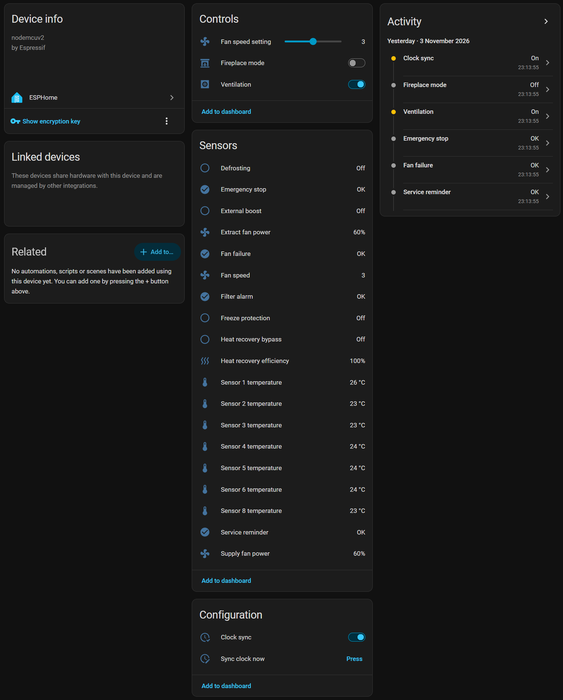
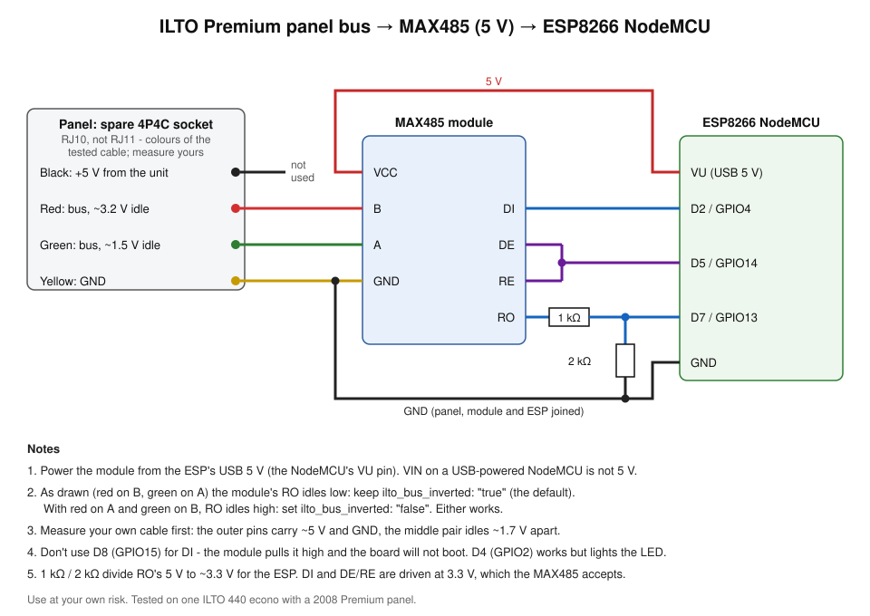

# esphome_ilto440

Home Assistant control for **ILTO / Swegon CASA ventilation units with the Premium control
panel**, through an ESP8266 on the panel's own cable. No changes to the unit, and the panel keeps
working.

> **Use at your own risk.** This is an unofficial, reverse-engineered integration with no
> connection to ILTO or Swegon. It sends commands to your ventilation unit and needs wiring into
> its control bus; a mistake can switch the ventilation off, change its settings or damage the
> hardware. It has been tested on one unit only (an ILTO 440 econo with a Premium panel from
> 2008). No warranty of any kind.
>
> The code, the protocol decoding and this documentation were written by Claude (Anthropic's AI
> assistant), working with the owner of the tested unit.

## What it does

- **Reads** the panel's temperature sensors 1-8, heat recovery efficiency, the selected fan speed,
  supply and extract fan power, fireplace mode, on/off state and the unit's status flags
  (filter alarm, defrosting, bypass, fan failure, ...).
- **Controls** the fan speed (1-5), fireplace mode and switches the unit on and off, by sending
  exactly the commands the panel sends, and checks that the unit acknowledged each one.
- **Keeps the unit's clock and weekday in sync** with Home Assistant (its weekly timer depends on
  them), after every boot and every night, so power cuts and daylight saving changes don't matter.

The device in Home Assistant (on the tested ILTO 440 econo, with the entities it lacks removed):



Everything is an ESPHome package: include one line, remove what your unit does not have.

**Not included, on purpose:** the panel's service and installation settings (weekly timer,
filter guard, summer cooling, heating, actuators, fan speed per mode, ...). They describe how the
unit is installed, and a wrong value can stop it from working properly, so they stay on the
panel. See [docs/protocol.md](docs/protocol.md#settings-not-decoded-on-purpose).

## Compatibility

Tested: ILTO 440 econo, Premium panel (2008, 4P4C sockets). The bus protocol is the one Swegon
CASA units use (see [docs/protocol.md](docs/protocol.md)), so other ILTO / Swegon CASA models with
the Premium panel are likely to work, possibly with a different set of sensors.

Units differ in the frame header. Two layouts are known, and the component recognises either one
by itself (the log says `Bus layout: ...` once the first frame arrives):

| Layout | Seen on | Reading | Control (speed, on/off, fireplace, clock) |
|---|---|---|---|
| ILTO, long header (`CC 64 4A 00 FD 00 FD ...`, panel is bus master) | ILTO 440 econo | Yes | Yes |
| CASA, short header (`CC 64 85 FD 0A ...`, unit is bus master) | ILTO 440 Premium (ESP32 + MAX3485) | Yes: temperatures, efficiency, fan power, running, Away / Home / Boost | Away / Home / Boost 30-120 min / Boost (the **Ventilation mode** select), off / on (the **Ventilation** switch), clock sync. Speed 1-5 and fireplace are not captured yet and are dropped with a warning |

## Parts

- ESP8266 board: tested on a LoLin NodeMCU v3
- 5 V RS-485 transceiver module with a MAX485 (the common blue/green board with DE, RE, DI, RO)
- Resistors 1 kΩ and 2 kΩ (or 2.2 kΩ) - level shifter for the module's output
- A 4P4C (RJ10) modular cable - **not RJ11**, which does not fit the panel's socket
- USB power supply for the ESP

## Wiring



| MAX485 module | Connect to |
|---|---|
| VCC | ESP's USB 5 V (VU on a NodeMCU) |
| GND | ESP GND and the cable's GND |
| A, B | The cable's middle pair (either way round, see polarity below) |
| RO | 1 kΩ to D7 (GPIO13), and 2 kΩ from D7 to GND |
| DI | D2 (GPIO4) |
| DE and RE, joined | D5 (GPIO14) |

The cable's other outer pin carries about 5 V from the unit; it is not needed.

Before connecting, find the pins with a multimeter, unit running, cable plugged into the panel's
spare socket:

1. Pin to pin, find the pair that reads about 5 V: those are the outer pins, GND and +5 V.
2. The two middle pins read roughly 3.2 V and 1.5 V to GND (about 1.7 V between them). That is
   the RS-485 pair.

**Polarity:** with the bus idle, the module's RO either sits low or high depending on which way
A and B are connected. Either works: keep `ilto_bus_inverted: "true"` (the default) if RO idles
low, set `"false"` if it idles high. The log tells you whether it is right (see Installation).

Pin notes (why not other pins):
- **D8 (GPIO15)** must be low at boot; the module pulls DI high, so the board would not start.
- **D4 (GPIO2)** works for DI but keeps the board's LED lit.
- **VIN** on a NodeMCU powered from USB is not 5 V. An unpowered module produces only noise.
- The ESP8266's hardware UART receives on GPIO13, so the serial log moves to UART1 (the package
  does this).

## Installation

1. Wire it as above. Plug the cable into the panel's spare socket (the one for chaining a second
   panel).
2. In ESPHome, create a device from [examples/ilto-minimal.yaml](examples/ilto-minimal.yaml) -
   change the name, and remove the entities your unit does not have (see below). Add
   `wifi_ssid`, `wifi_password`, `api_encryption_key` and `ota_password` to your `secrets.yaml`.
3. Flash it once over USB, then over the air.
4. Open the device's log. Every 10 s it prints a line like:

   ```
   bytes 3339, frames ok 150, bad crc 0, last bytes: ...
   ```

   - `frames ok` growing and `bad crc 0`: all good.
   - `bytes` growing but `frames ok 0`: flip `ilto_bus_inverted` (with an automatic-direction
     module, swap A and B instead; see the ESP32 example). If that does not help, see
     Troubleshooting for capturing the raw frames.
   - `bytes 0`: no signal - check the module's power, GND and the A/B wires.
5. Add the device in Home Assistant. Check the temperatures against the panel's sensor screens
   (service menu), then try the fan speed.

## Configuration

### The package

```yaml
packages:
  ilto: github://quasd/esphome_ilto440/packages/ilto_premium.yaml@main
```

Substitutions (set them in your device file to override):

| Substitution | Default | Meaning |
|---|---|---|
| `ilto_rx_pin` | `GPIO13` | Receives from the module's RO (must be GPIO13 for the hardware UART) |
| `ilto_tx_pin` | `GPIO4` | Sends to the module's DI (software UART) |
| `ilto_flow_control_pin` | `GPIO14` | Drives DE + RE, high while sending |
| `ilto_bus_inverted` | `"true"` | `"true"` if RO idles low, `"false"` if high |
| `ilto_components` | `github://quasd/esphome_ilto440@main` | Where the C++ component comes from; a local path for development |

### Removing what your unit does not have

Read the panel's sensor, CO2, humidity and rpm screens. Anything that shows 0, or 111 °C for a
temperature, is not fitted:

```yaml
ilto_premium:
  temperature_7: !remove
  co2: !remove
  humidity: !remove
  supply_fan_rpm: !remove
  extract_fan_rpm: !remove
```

### Renaming entities

```yaml
ilto_premium:
  temperature_1:
    name: "Outdoor air temperature"   # once you know which duct sensor 1 measures
```

### Examples

| File | What it shows |
|---|---|
| [examples/ilto-minimal.yaml](examples/ilto-minimal.yaml) | The tested unit's configuration: the package plus `!remove` |
| [examples/ilto-custom-pins.yaml](examples/ilto-custom-pins.yaml) | The same with DI and DE/RE on other pins |
| [examples/ilto-esp32-auto-direction.yaml](examples/ilto-esp32-auto-direction.yaml) | ESP32 with a 3.3 V RS-485 module that switches direction by itself (MAX3485 boards without DE/RE pins): no resistors, `ilto_bus_inverted: "false"`, A/B the right way round. Also the CASA-layout unit's setup: Ventilation mode select, Ventilation on/off switch, Boost time left, Unit clock |

From your own ESPHome lambdas the component offers:

```cpp
id(ilto).set_mode(3);             // 0 = off, 1-5 = speed, 6 = fireplace (as the Ventilation control)
id(ilto).set_fan_speed(3);        // 1-5
id(ilto).set_power(false);        // switch the unit off / on
id(ilto).set_fireplace(true);     // fireplace mode on / off
id(ilto).set_clock(weekday, hour, minute, second);  // weekday: Monday = 0
id(ilto).set_step(2);             // CASA layout: 0 Away, 1 Home, 2-4 Boost 30/60/120 min, 5 Boost
```

## Entities

| Entity | Type | Notes |
|---|---|---|
| Sensor 1-8 temperature | sensor, °C | Numbered as on the panel. Which duct each measures depends on the unit. The unit sends whole degrees; the 15 s average shows one decimal, which tells roughly where between two whole degrees the reading sits |
| Heat recovery efficiency | sensor, % | |
| Fan speed | sensor | Selected speed 1-5, 0 while the unit is off. Unknown while the panel shows the 3-step Away / Home / Boost screen, which does not report the speed, and always on the CASA layout |
| Supply fan power, Extract fan power | sensor, % | 0 when the unit is off |
| CO2, Humidity | sensor | Only with those options; scale unchecked |
| Supply fan rpm, Extract fan rpm | sensor | Not reported by econo models |
| Ventilation | select | Off, 1-5 or Fireplace: the unit's state, and how to change it. Right after switching on, the unit keeps its start speed for about a minute before a new speed takes effect (Supply / Extract fan power show when). Fireplace runs supply 100 %, extract 20 % for ~10 min to start a fire, then the unit returns to its speed |
| Ventilation mode (`step_mode`) | select | CASA layout only, not in the package (see the ESP32 example): Away, Home, Boost 30 / 60 / 120 min, Boost - the panel's 3-step screen. Shows the unit's choice and sends the panel's command |
| Boost time left (`boost_time`) | sensor, min | CASA layout only: minutes left of a timed boost, 0 otherwise. The unit reports only the boost's length, so the ESP counts from when the boost started; for a boost already running when the ESP started it is unknown |
| Ventilation (`ventilation`) | switch | Optional, not in the package: the unit on / off, as the panel's main menu. Used by the ESP32 example for the CASA layout, where the speed select's commands are not known |
| Unit clock (`unit_clock`) | text sensor (diagnostic) | CASA layout only, not in the package: the unit's own weekday and time, e.g. `Fri 19:23` |
| Clock sync | switch (config) | On by default: set the unit's clock after boot and at 04:05 daily |
| Sync clock now | button (config) | |
| Heat recovery bypass, External boost, Defrosting, Freeze protection, Filter alarm, Service reminder, Fan failure, Emergency stop | binary sensor | Bit positions from the openHAB binding, not yet seen changing on an ILTO |

All sensors have device and state classes, so Home Assistant keeps long-term statistics.

## How it works

The panel polls the unit about once a second over RS-485 at 38400 baud and sends a command only
when you confirm a setting. The ESP listens to all of it, and to send, waits for a pause between
polls, sends the panel's own command frame, and resends until the unit acknowledges (at most 3
tries). Frame format, every known command and status byte, and what is still unknown:
[docs/protocol.md](docs/protocol.md).

Two design points worth knowing:
- The Ventilation control shows the unit's own state and never acts at boot, so
  restarting or updating the ESP never switches the unit off.
- Choosing the state the unit is already in sends nothing, and changing it sends only the steps
  needed (switch on first, end fireplace mode first), so automations can set it as often as they
  like.

## Troubleshooting

| Symptom | Cause |
|---|---|
| `bytes 0` in the log | No signal: module power (VIN is not 5 V on USB), GND not connected, or A/B not on the middle pair |
| `bytes` growing, `frames ok 0` | Polarity: flip `ilto_bus_inverted`. If the last bytes look sensible (small numbers like room temperatures) the polarity is right and the unit may use an unknown frame layout: capture whole frames with the snippet below and open an issue |
| "... is not known on the CASA (short header) bus layout; not sent" | Expected for the speed and fireplace commands on that layout; use the Ventilation mode select and the Ventilation switch |
| Board does not boot after wiring | DI on D8 (GPIO15). Use D2 |
| Commands log "No acknowledgement" | DE/RE not connected to the flow control pin, or DI not wired |
| Home Assistant cannot connect, log says "Max connections" | Too many log sessions open (the ESP8266 allows 4); close them |
| Temperatures look wrong | Compare with the panel's sensor screens; sensor numbers differ between units |

To see every frame on its own log line (frames are separated by short pauses), add this to the
device file and look for `uart_debug` lines:

```yaml
uart:
  - id: !extend ilto_bus_rx
    debug:
      direction: RX
      dummy_receiver: false
      after:
        timeout: 5ms
      sequence:
        - lambda: UARTDebug::log_hex(direction, bytes, '.');
```

## For AI assistants

[.claude/skills/esphome-ilto440/SKILL.md](.claude/skills/esphome-ilto440/SKILL.md) is a skill
for AI coding assistants (Claude Code and others that read skills) working on this repository:
the protocol in short, the design rules, the traps found during development and how to test a
change.

## Credits

The message types and data layouts started from openHAB 1's `swegonventilation` binding, which
documented the Swegon CASA bus for reading. The ILTO frame header, the length byte, the commands,
the clock messages and the checked byte meanings were found by sniffing the tested unit's bus.

## License

[0BSD](LICENSE) (Zero-Clause BSD): use, copy, change and share it for any purpose, with or
without credit. Provided without any warranty - see the disclaimer at the top.
